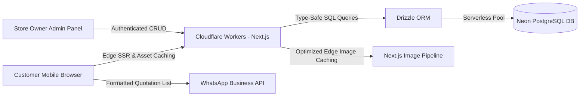

<h1>🎨 Shree Balaji Paints, Plywood & Hardware</h1>

<strong>A phone-first digital product catalogue, quotation builder, paint calculator, and store management platform built for an authorised Asian Paints dealer in Kotul.</strong>

---

> **🔒 Intellectual Property Notice:** This repository serves as a **public case study & architecture showcase**. Because this is a commercial production system built for a live retail client by **<a href="https://software-studio.nexoralab.workers.dev/" target="_blank" rel="noopener noreferrer">Nexora Studio</a>**, the proprietary source code is maintained in a private repository.

---

## 📸 Storefront Overview

Designed for homeowners, painters, and contractors in Kotul, blending trustworthy local Marathi messaging (*"घर सजवण्यासाठी लागणारं सगळं — एकाच ठिकाणी"*) with a fast, modern product discovery experience.

---

## 🛍️ Live Product Catalogue & Visual Media Pipeline

Instead of static hard-coded assets, product categories and inventory items are dynamically served from **Neon Serverless PostgreSQL** via **Drizzle ORM** and optimized through Next.js edge media routes.

|                                                               🎨 Authorised Paints (26+ Products)                                                              |                                                                             🧱 Paint Preparation (21+ Products)                                                                            |                                                                            🖌️ Painting Tools (18+ Products)                                                                            |
| :------------------------------------------------------------------------------------------------------------------------------------------------------------: | :----------------------------------------------------------------------------------------------------------------------------------------------------------------------------------------: | :-------------------------------------------------------------------------------------------------------------------------------------------------------------------------------------: |
|  |  |  |

|                                                                              🪵 Plywood & Boards (12+ Products)                                                                             |                                                              ✨ Decorative Laminates (16+ Products)                                                             |                                                                              🚪 Doors & Hardware (11+ Products)                                                                             |
| :-----------------------------------------------------------------------------------------------------------------------------------------------------------------------------------------: | :------------------------------------------------------------------------------------------------------------------------------------------------------------: | :-----------------------------------------------------------------------------------------------------------------------------------------------------------------------------------------: |
|  |  |  |

---

## 🚀 Key Product Features Engineered

### 1. 📋 Interactive Quotation Builder & WhatsApp Enquiry Flow
In local hardware, plywood, and paint retail, rates fluctuate daily and customers prefer confirming bulk rates on WhatsApp rather than using standard e-commerce checkouts.
- Customers browse categories and add paints, primers, plywood sheets, and fittings to a custom **Quotation List** (`/quotation`).
- One-tap export formats the entire itemised list into a structured **WhatsApp enquiry** sent directly to the shop owner (`+91 7038499108`).

### 2. 🧮 Built-In Paint Coverage Calculator
Homeowners rarely know how many litres of primer, putty, or emulsion are required for their walls. The built-in calculator estimates material quantities based on dimensions before the customer sends an enquiry.

### 3. 🔐 Self-Service Owner Admin Panel
Gives the store owner full autonomy to:
- Add, edit, and toggle stock status for products across 7+ categories.
- Upload and manage product photography dynamically.
- Publish seasonal and festive discounts on the **Offers** page (`/offers`) without developer intervention.

---

## 🏗️ System Architecture

## ⚡ Technical Highlights

* **Edge-First Deployment:** Hosted on **Cloudflare Workers** for near-zero cold starts and fast page loads on mobile connections.
* **Type-Safe Data Layer:** Powered by **Neon Serverless PostgreSQL** and **Drizzle ORM** for minimal bundle overhead on edge runtimes.
* **Bilingual & Accessible UX:** Semantic HTML5 landmarks, screen-reader support, and native `lang="mr"` Devanagari typography alongside English navigation.

---

## 📬 Architected & Delivered By

**Shubham Deshmukh** — Founder & Lead Developer at **<a href="https://software-studio.nexoralab.workers.dev/" target="_blank" rel="noopener noreferrer">Nexora Studio</a>**

* 🌐 **Studio Website:** <a href="https://software-studio.nexoralab.workers.dev/" target="_blank" rel="noopener noreferrer">software-studio.nexoralab.workers.dev</a>
* 💼 **LinkedIn:** <a href="https://www.linkedin.com/in/shubham-deshmukh1720" target="_blank" rel="noopener noreferrer">linkedin.com/in/shubham-deshmukh1720</a>
* 💻 **GitHub:** <a href="https://github.com/shubhamdsk" target="_blank" rel="noopener noreferrer">@shubhamdsk</a>
